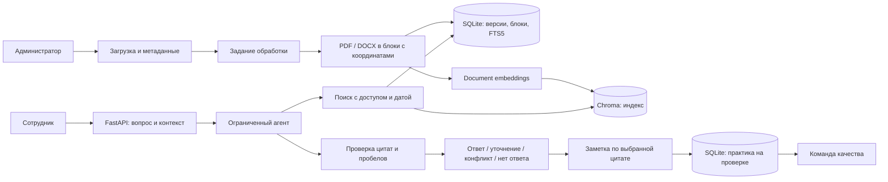

# Проект архитектуры перед спринтом

План от 25 ноября 2026 года. Работающие маршруты описаны в
[реализованном API](API.md). Небольшой файловый корпус ожидается двумя
наборами: регламенты и материалы по продуктам и лицензированию.
Первый проход включает импорт из папок, FTS5 и ответ с несколькими цитатами.
За ним идут сбор практики применения и публикация стенда. Векторный индекс
и веб-импорт добавляются после проверки основного сценария.

## Общий процесс

UI не имеет прямого доступа к Chroma или ключам провайдеров. Backend получает
principal из проверенного контекста; в локальном демо используется явно
обозначенный тестовый пользователь и ограниченный корпус.
Парсинг, embeddings, извлечение контекста и генерация выполняются в контуре
команды. Chat и embeddings дают отдельные локальные endpoint'ы. Поиск по
FTS5 остаётся доступен как явный режим, когда векторный поиск отключён.

## Границы модулей

Структура и ответственность каталогов описаны в [backend](../../backend/README.md)
и [frontend](../../frontend/README.md). SDK и инфраструктура остаются за
интерфейсами ChatProvider, EmbeddingProvider, VectorIndex, DocumentParser,
DocumentRepository. На старте не нужны отдельные сервисы для каждого интерфейса.

SQLite — источник истины. Chroma хранит поисковое представление; её можно
перестроить из оригиналов, блоков, настроек chunking и выбранного embedding profile.
Административные операции отделены от read-only инструментов агента.
Поле corpus_kind различает regulations и product_licensing. Фильтр по набору
поддерживает уточнение запроса. Для сквозного вопроса поиск охватывает оба набора.

## Практика применения

После ответа сотрудник выбирает конкретную цитату и самостоятельно отправляет
ситуацию и предпринятый шаг. Приложение проверяет связь цитаты с данным
ответом, доступ к её источнику и сохраняет запись в SQLite. В записи
остаётся версия документа даже после появления новой редакции.

Минимум для показа — сохранить запись, вернуть подтверждение и дать команде
качества посмотреть очередь через служебную команду или доступный ей экран.
Система ставит исходный статус `pending_review`. Эту запись видят автор
и проверяющий в пределах их доступа. Пункт документа остаётся неизменяемым.
Оценка полезности ответа ведётся отдельно от сведений о практике.

Если останется время и подтверждён владелец процесса, добавить просмотр
одобренных примеров отдельным блоком для соответствующего пункта и редакции.
Роль проверяющего и область показа проверить на кик-оффе. Появление нового
примера не меняет нормативный поиск, порядок редакций и доказательность
выводов. Заметка содержит пользовательский текст и проходит те же проверки
доступа и вывода, что и другие пользовательские данные.

## Загрузка и извлечение

1. Проверить права загрузки, расширение и тип содержимого, размер и формат.
   Сервер генерирует storage key; имя пользователя не становится путём на диске.
2. Сохранить неизменяемый оригинал, content hash, источник, владельца,
   семейство документа и версию метаданных. Создать сохраняемое задание.
3. PDF: извлекать текст/таблицы по страницам с физическим номером и при наличии
   печатной меткой. Плохой порядок чтения/пустой текст — предупреждение качества.
4. DOCX: сохранить порядок абзацев и таблиц, заголовки, индексы строк/ячеек,
   служебные блоки отдельно. Не приписывать стабильную пагинацию исходному DOCX.
5. Нормализовать пробелы/поисковый текст отдельно от оригинального текста.
   Сохранить locator до разбиения на чанки; не восстанавливать страницы по длине текста.
6. Разбивать по смысловым разделам/пунктам и границам таблиц. Сохранять связи
   chunk → исходные block ID + диапазоны; заголовок и реквизиты наследуются явно.
7. Записать канонические блоки/чанки в SQLite, подготовить FTS5 и embeddings.
   Проверить число записей, размерности и возможность прочитать их из индекса.
8. Только после успешной проверки опубликовать поисковую генерацию в SQLite.

Точные размеры чанков определяются после просмотра материалов и лимитов модели
embeddings. Начальная гипотеза — 400–700 токенов с небольшим overlap, без
разрыва пункта/строки таблицы. Это не измеренный оптимум и не универсальное правило.

Сканы получают `needs_ocr`, защищённые файлы — понятную ошибку. Пустое извлечение
не считается успешной индексацией. OCR, вложения, исправления Word и сложные
многоуровневые таблицы включаются после оценки корпуса. Неподдержанные части
не должны исчезать молча: фиксировать предупреждения и ограничения покрытия.

CPU-разбор не выполняется в HTTP event loop. На первом этапе — один ограниченный
runner и отдельный процесс разбора с лимитами ресурсов/времени. В очереди задания
сохраняются в SQLite. После рестарта прерванный разбор помечается, повтор запускается
идемпотентно с новым attempt; частично построенный индекс не выдаётся пользователю.

## Две независимые оси: обработка и действительность

| Ось | Примеры состояний | Кто определяет |
| --- | --- | --- |
| Обработка | uploaded, extracting, indexing, ready, needs_ocr, failed | Проверяемые результаты runner |
| Публикация/применимость | unverified, draft, approved, withdrawn | Разрешённый администратор по данным заказчика |
| Период действия | effective_from, effective_to, неизвестно | Реквизиты/официальный источник, подтверждённые метаданные |
| Поисковая генерация | building, ready, active, retired, failed | Сервис индекса и публикация в SQLite |

Загружен позже ≠ действует позже. Действует сегодня ≠ применим к вопросу о прошлом.
Приказы, положения, письма и чаты не имеют универсального старшинства без правил
применимости. По FAQ иерархию обосновывает команда. Для MVP опираться на
подтверждённые связи редакций, даты, явное исключение и область действия.
Уточняются юридическое лицо, продукт, тип лицензии или договора, полномочия и дата.

Для нормативного ответа по умолчанию нужны подтверждённые применимость и период
действия. Неизвестная/черновая версия не становится действующей автоматически.
Если подтверждённых оснований нет, результат — нехватка сведений с указанием
непроверенного источника только в разрешённом режиме, без нормативного утверждения.

Связи `supersedes`, `amends`, `related_to` хранятся явно. Частичное изменение
пункта не отменяет целый документ автоматически. Конфликт разрешается правилами
заказчика или человеком; оценка близости вектора не определяет юридическую силу.

## Гибридный поиск

FTS5 — первый рабочий режим и база для измерения качества. Шаги с query
embeddings, Chroma и объединением рангов включаются в hybrid-режиме.

1. Зафиксировать дату вопроса, разрешённую область и активную генерацию корпуса.
2. Искать параллельно точные термины через FTS5 и смысл через query embeddings/Chroma.
3. В обоих каналах учитывать доступ и применимость. Chroma получает разрешающие
   фильтры; каждый кандидат дополнительно проверяется по актуальным данным SQLite.
4. Объединить кандидатов по рангам (RRF), убрать дубликаты/overlap. Не складывать
   напрямую несопоставимые BM25 и vector distance.
5. Получить оригинальные блоки из SQLite и соседние пункты в пределах контекста.
   Учитывать таблицы, реквизиты и условия действия, а не один похожий абзац.
6. Если данных мало, выполнить ограниченный дополнительный поиск/уточнение.

У FTS5 нет гарантии полноценной русской морфологии в нашей ещё не настроенной
схеме. Нормализация аббревиатур/ё и расширение запроса проверяются на корпусе;
оригинальный текст цитат сохраняется отдельно. Номер приказа и слово «агентский»
не должны исчезать после перефразирования моделью.

Для начала: до 20 кандидатов каждого канала, до 6 фрагментов итогового контекста.
Это проектные лимиты для измерений. Релевантность и достаточность доказательств
проверяются на контрольных вопросах; расстояние Chroma не является вероятностью
истинности. Нельзя отвечать только потому, что top-k вернул хоть что-то.

## Что делает агент

Инструменты: `search_documents`, `get_passages`, `get_document_metadata`,
`get_related_versions`. Scope/ACL наследуются сервером; модель не может заменить
их аргументами. Полученные документы — данные, а не дополнительные инструкции.

Агент решает, нужны ли второй запрос, соседний пункт, проверка версии или
уточняющий вопрос. В журнале показываются вызовы, источники и результаты,
а не внутренние рассуждения. Это ограниченная агентность вокруг RAG, без
изменений во внешних системах и свободного доступа в интернет.

Пример многошагового сценария: найти пункт о подписанте, получить упомянутый
приказ о делегировании, проверить применимость к юрлицу и дате, затем связать
условие и полномочие двумя ссылками. Если второй источник отсутствует,
выдать подтверждённую часть и указать, какой документ нужен.

Начальные бюджеты: до 3 поисков, 2 расширений контекста, 8 tool calls суммарно,
4 LLM calls и 45 секунд на ответ, включая повторы. Размер контекста и время
отдельной попытки ограничиваются оставшимся бюджетом. Пустой/повторяющийся
поиск не запускается бесконечно. Ошибка провайдера не маскируется как «ответа нет».

## Формирование ответа и цитат

LLM получает только разрешённые фрагменты и серверные citation IDs. Возвращает
пункты ответа с references, missing_information, conflicts и outcome.
Сервер валидирует схему, ID, принадлежность версии, locator, совпадение выдержки
и доступ. Затем проверяется поддержка утверждения содержимым: валидный ID
не доказывает, что ответ следует из источника. Это отдельная проверка и оценка качества.

Исходы: `answered`, `partial`, `needs_clarification`, `not_found`, `conflict`.
Технический сбой — отдельный failed status, а не один из смысловых исходов.
Неподтверждённое имя подписанта, срок или полномочие не попадают в нормативный ответ.
Для DOCX отображается пункт/абзац/таблица; PDF может открываться на странице
неизменяемого оригинала. Выдержки берутся из сохранённого разбора, не сочиняются LLM.

## Согласованность SQLite и Chroma

Общей транзакции между хранилищами нет. Новая генерация строится под отдельным
generation_id/collection, а старый индекс остаётся доступным. Публикация
указателя выполняется в SQLite после проверки готовности обеих частей.
Запрос не смешивает поколения. Сбой до публикации оставляет только building/failed.

Embedding profile включает провайдера, document/query models, версии/размерность,
нормализацию и chunking/parser version. Совместимые query/document модели могут
различаться; принадлежность одному профилю должна быть явной. Смена профиля требует
переиндексации. Если провайдерный alias меняется, зафиксировать это как ограничение
воспроизводимости и проверить необходимость новой генерации.

Удаление сначала закрывает доступ/помечает tombstone в SQLite, затем удаляет
векторные записи. Старые индексы не должны возвращать удалённое в контекст.
Перед выдачей ответа/цитат/истории доступ проверяется повторно. При изменении
корпуса во время ответа — контролируемый retry в бюджете или stale_corpus.
Не кэшировать готовые ответы в первом MVP; позднее нужен ключ с ACL и revision.

## Доступ и хранение

- Подготовленный корпус обезличен. Оригиналы и индексы хранятся в контуре
  команды и исключены из Git. Цитаты из корпуса можно показывать в конкурсном видео.
- Роли и корпоративное SSO относятся к дополнительной демонстрации.
  В первой версии достаточно одного локального пользователя.
- Проверять principal для API, оригинала, цитат и истории. groups/user_id из тела
  запроса не расширяют доступ; фильтры пользователя могут только сужать scope.
- При отзыве доступа к использованному документу не выдавать сохранённый ответ
  из истории со скрытой цитатой, но раскрытым текстом: требуется проверка всей записи.
- Не вызывать URL/команды/макросы из документов. Не исполнять инструкции внутри
  retrieved text. Файлы ограничиваются по размеру, времени разбора и распаковке DOCX.
- В обычных логах — ID, статусы, длительность и usage; тексты документов,
  вопросы сотрудников и ключи требуют отдельной политики хранения.
- Для локального прогона использовать localhost. Стенд открывает жюри
  только интерфейс и нужные маршруты API через единый HTTPS-вход. Согласовать
  режим входа, разрешённый демо-корпус и правила показа источников. Порты
  llama.cpp и Chroma, файлы SQLite и административные операции остаются
  внутри контура команды. [Публикация стенда](../../infra/docker/README.md#публикация-на-linux).

## Что не нужно усложнять на старте

Несколько агентов, брокер сообщений, Kubernetes, дообучение, knowledge graph,
автоматические коннекторы к почте и отдельная платформа прав. Их добавление
должно следовать из задания или измеренной проблемы, а не из общего списка технологий.
