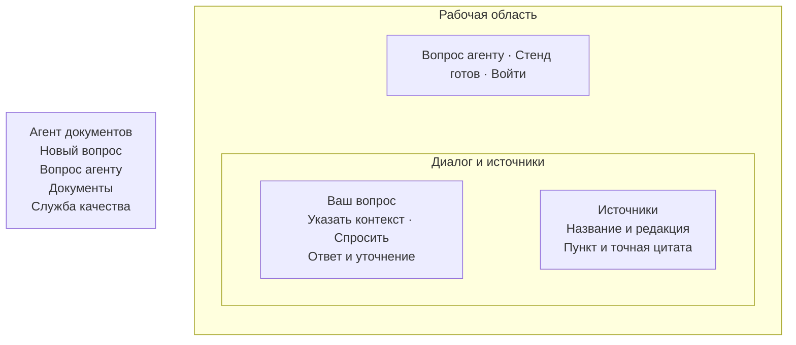

# Макет интерфейса

Схема актуального экрана на стенде. [Открыть стенд](https://d5d4n1iop8aguhgmqkkj.p8361f8z.apigw.yandexcloud.net/).

## Другие экраны

| Экран | Что можно сделать |
| --- | --- |
| **Документы** | Выбрать доступный регламент из списка и открыть его текст |
| **Цитата из источника** | Прочитать фрагмент и сверить редакцию, пункт и соседний текст |
| **Служба качества** | Открыть обращение и тестовую переписку, проверить цитаты и опубликовать или отозвать консультацию |

[Роли и вход на стенд](../../README.md#доступ-к-стенду).
